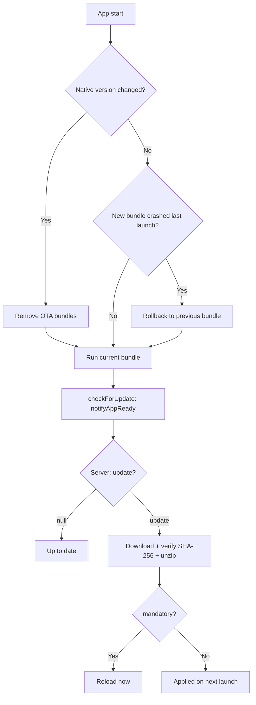

# 📦 React Native OTA

A lightweight React Native TurboModule library for Over-The-Air (OTA) updates, allowing seamless JavaScript bundle updates without requiring a full app store release.

> ## 🚨 The update flow has changed (2.x)
>
> If you are upgrading from 1.x, your app code **and your server** must be updated:
>
> | | 1.x | 2.x |
> |---|---|---|
> | App code | `fetch` version → compare → `downloadBundle` → `reloadApp` | One call: `checkForUpdate(url)` |
> | Server | `/ota/version` returns `{ versionCode }` + one bundle URL per platform | One check endpoint that receives the app's native version and returns `{ update: { version, url, sha256, mandatory } \| null }` ([see Server](#-server)) |
> | When the update applies | Immediately (`reloadApp`) | **On the next app launch**. Immediately only when `mandatory: true` |
> | Broken bundle | App crashes on every launch | **Automatic rollback** to the previous bundle |
> | Bundle zip | Bundle only | Bundle **+ assets** (use the new [build scripts](#-script-build-bundle)) |
>
> If you keep calling the low-level `downloadBundle()` yourself, you **must** call `notifyAppReady()` once your app has started, otherwise the bundle is rolled back on the next launch. `checkForUpdate()` does it for you.
>
> OTA bundles downloaded with 1.x are removed on first launch after the upgrade.

## ✨ Features

- **One call** to check, download and install updates: `checkForUpdate()`.
- **Server-driven**: the app sends its native version, the server decides which bundle (if any) is compatible.
- **Applied on next launch** by default, no interruption for the user. Mandatory updates reload immediately.
- **Automatic rollback**: a bundle that crashes before `notifyAppReady()` is replaced by the previous one and never downloaded again.
- **Integrity check** with SHA-256, **download/unzip progress** events.
- **Assets support** (images, fonts, ...) shipped inside the bundle zip.
- **Automatic cleanup** of OTA bundles when the app is updated via App Store or Google Play.

## 🚀 Installation

Install the library using your preferred package manager:

```bash
yarn add react-native-bundle-ota
# or
npm install react-native-bundle-ota
```
IOS
```
cd ios && pod install
```

## 🛠️ Config

IOS: in Appdelegate.swift

```Appdelegate.swift
import Ota
...

class ReactNativeDelegate: RCTDefaultReactNativeFactoryDelegate {
  override func sourceURL(for bridge: RCTBridge) -> URL? {
    self.bundleURL()
  }

  override func bundleURL() -> URL? {
#if DEBUG
    RCTBundleURLProvider.sharedSettings().jsBundleURL(forBundleRoot: "index")
#else
    return OtaHelper.bundleURL() // <--add this
#endif
  }
}
```
Android: In MainApplication.kt 

```MainApplication.kt
//import this
import java.io.File
import com.ota.OtaHelper
...
... 

//config
 override fun getJSBundleFile(): String? {
        val otaFile: File? = OtaHelper.getBundleFile(applicationContext)
        return otaFile?.absolutePath ?: super.getJSBundleFile()
      }
```


## 📦 Script build bundle

Add 2 scripts for build bundle file .zip in package.json

```package.json
 "scripts": {
   ...

    "bundle:ios": "rm -rf ota/ios && mkdir -p ota/ios && react-native bundle --entry-file index.js --platform ios --dev false --minify true --bundle-output ota/ios/main.jsbundle --assets-dest ota/ios && cd ota/ios && zip -qr ../main.jsbundle.zip . && shasum -a 256 ../main.jsbundle.zip",
    "bundle:android": "rm -rf ota/android && mkdir -p ota/android && react-native bundle --entry-file index.js --platform android --dev false --minify true --bundle-output ota/android/index.android.bundle --assets-dest ota/android && cd ota/android && zip -qr ../index.android.bundle.zip . && shasum -a 256 ../index.android.bundle.zip"
  }
```

Output: `ota/main.jsbundle.zip` (iOS) and `ota/index.android.bundle.zip` (Android), plus their SHA-256 printed at the end. Upload the zip to your server together with its SHA-256, and add `ota/` to `.gitignore`. The scripts need macOS/Linux (`rm`, `zip`, `shasum`).

The zip must contain the bundle **and its assets** at the root:

```
main.jsbundle.zip            index.android.bundle.zip
├── main.jsbundle            ├── index.android.bundle
└── assets/...               ├── drawable-mdpi/...
                             ├── drawable-xxhdpi/...
                             └── raw/...
```

> ⚠️ When the app runs an OTA bundle, React Native loads **every** image (`require('./img.png')`) from the folder next to the bundle, not from the app binary. A zip without assets means missing images.
>
> ⚠️ Do not write the OTA bundle into `android/app/src/main/assets` / `android/app/src/main/res` or `ios/`: on Android this causes `Duplicate resources` errors in the release build.

## ⚡ Server

The app makes a single request:

```
GET <checkUrl>?platform=ios&nativeVersion=1.2.0(15)&bundleVersion=5
```

| Query | Meaning |
|---|---|
| `platform` | `ios` or `android` |
| `nativeVersion` | Version of the installed binary: `versionName(versionCode)` on Android, `CFBundleShortVersionString(CFBundleVersion)` on iOS |
| `bundleVersion` | Version of the OTA bundle currently installed, `0` if none |

Respond with `{ "update": null }` when there is nothing to install, otherwise:

```json
{
  "update": {
    "version": 6,
    "url": "https://cdn.example.com/ota/ios/6/main.jsbundle.zip",
    "sha256": "3f2a...",
    "mandatory": false
  }
}
```

| Field | Required | Meaning |
|---|---|---|
| `version` | ✅ | Integer, unique per bundle. Must differ from `bundleVersion` to trigger a download |
| `url` | ✅ | Zip built with the scripts above, for this platform |
| `sha256` | recommended | Hash of the zip. The download is rejected if it does not match |
| `mandatory` | | `true` reloads the app right after download. Default: applied on next launch |

> ⚠️ Only return a bundle that was built for the same native code as `nativeVersion` (same React Native version, same native modules). A bundle that needs a native module the installed binary does not have will crash (and then be rolled back).

Minimal Express example:

```js
// One entry per platform + native version
const releases = {
  'ios/1.2.0(15)': { version: 6, url: 'https://.../ios-6.zip', sha256: '...', mandatory: false },
  'android/1.2.0(15)': { version: 6, url: 'https://.../android-6.zip', sha256: '...' },
};

app.get('/ota/check', (req, res) => {
  const { platform, nativeVersion, bundleVersion } = req.query;
  const release = releases[`${platform}/${nativeVersion}`];
  if (!release || release.version === Number(bundleVersion)) {
    return res.json({ update: null });
  }
  res.json({ update: release });
});
```

Use HTTPS in production: release builds block plain HTTP (Android cleartext policy, iOS App Transport Security).

## 📖 Usage

Call `checkForUpdate()` once when your app starts:

```tsx
import { useEffect } from 'react';
import { checkForUpdate } from 'react-native-bundle-ota';

export default function App() {
  useEffect(() => {
    checkForUpdate('https://your-server.com/ota/check', {
      // Optional
      headers: { Authorization: 'Bearer ...' },
      onProgress: ({ phase, progress }) => {
        // phase: 'download' | 'unzip', progress: 0-100 (-1 if the server sends no Content-Length)
        console.log(`${phase}: ${progress}%`);
      },
    })
      .then((result) => {
        // 'up-to-date'  : nothing to do
        // 'downloaded'  : installed, applied on next launch (or reloading now if mandatory)
        // 'skipped'     : this version crashed before and was rolled back, not downloaded again
        console.log(result.status);
      })
      .catch((e) => console.warn('OTA update failed:', e));
  }, []);

  // ...
}
```

`checkForUpdate()` does, in order:

1. `notifyAppReady()`: the JS reached this point, so the running bundle is marked as working.
2. Calls your server with `platform`, `nativeVersion` and `bundleVersion`.
3. Downloads, checks the SHA-256, unzips and installs the bundle.
4. Reloads the app if `mandatory` is `true` (set `reloadIfMandatory: false` to handle it yourself, e.g. show a dialog then call `reloadApp()`).

### Rollback

```
download v6 ──▶ next launch runs v6 ──▶ JS calls notifyAppReady() ──▶ v6 confirmed
                       │
                       └─ crash before notifyAppReady() ──▶ next launch runs v5 again
                                                            v6 is reported by getFailedVersion()
                                                            and skipped by checkForUpdate()
```

Call `checkForUpdate()` (or `notifyAppReady()`) early: if the user closes the app before it runs, that launch counts as a failure.

## 🔍 API Reference

| Method | Description |
| --- | --- |
| `checkForUpdate(checkUrl: string, options?: { headers?, onProgress?, reloadIfMandatory? }): Promise<{ status: 'up-to-date' \| 'downloaded' \| 'skipped'; update? }>` | Confirms the running bundle, asks the server for an update, downloads and installs it. |
| `notifyAppReady(): void` | Marks the running OTA bundle as working. Without it, the next launch rolls back. Called by `checkForUpdate()`. |
| `downloadBundle(url: string, versionCode: number, sha256?: string): Promise<{ status: boolean; message: string }>` | Low-level: downloads, verifies and installs a bundle zip. Applied on next launch. |
| `addProgressListener(listener: (e: { phase: 'download' \| 'unzip'; progress: number; received: number; total: number }) => void): EventSubscription` | Listens to download/unzip progress. `progress` is 0-100, or `-1` when the server sends no `Content-Length`. Call `.remove()` to unsubscribe. |
| `reloadApp(): Promise<string>` | Applies the installed bundle now. Restarts the app process on Android, reloads the JS on iOS. |
| `getSavedVersion(): number` | Version of the installed OTA bundle, `0` if none. |
| `getFailedVersion(): number` | Last version that was rolled back, `0` if none. |
| `getNativeVersion(): string` | Native version sent to the server, e.g. `1.2.0(15)`. |
| `removeBundle(): Promise<{ status: boolean; message: string }>` | Removes every OTA bundle; the embedded bundle is used on next launch. |

## ⚠️ Important Notes

- **OTA vs. Store Updates**: OTA updates are for JavaScript bundle changes only. Native code changes still require official App Store or Google Play updates.
- **Version Conflict Handling**:
  - When the app is updated via App Store or Google Play, the library compares the native version (iOS `CFBundleShortVersionString` + `CFBundleVersion`, Android `versionName` + `versionCode`) with the one stored at the last launch.
  - If it differs, the old OTA bundle is automatically removed and `getSavedVersion()` is reset to `0`.
- **Reload**: on Android `reloadApp()` restarts the app process (the bundle path is only read when React Native starts). On iOS it reloads the JS in place.
- **Storage**: each install lives in its own folder (`filesDir/ota/` on Android, `Library/ota/` on iOS, excluded from iCloud backup). At most the current and previous bundles are kept.
- **Hermes**: the OTA bundle is plain JS. Hermes can run it, but startup is slower than bytecode. To ship bytecode, compile the bundle with `hermesc -emit-binary -O` (from `node_modules/react-native/sdks/hermesc`) before zipping.
- **Best Practices**: Always test OTA updates thoroughly to ensure compatibility with your app’s native codebase.

## 📹 Demo

_(Insert a GIF or video here to showcase OTA updates in action. For example, demonstrate downloading a bundle and reloading the app.)_

## 🔄 OTA Update Workflow

The following diagram illustrates the OTA update process:



## 📝 License

This project is licensed under the MIT License.

## 🙌 Contributing

Contributions are welcome! Please open an issue or submit a pull request on [GitHub](https://github.com/DucNhatNguyen23/react-native-ota).
